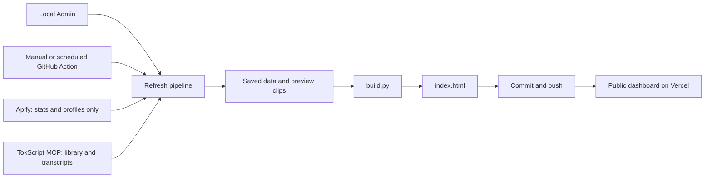

# Outlier Lab

Track the top reels across the creators in your niche. Search creators with a live admin UI, choose when to refresh, and get a dashboard with spoken-hook transcripts and 3-second autoplay hook clips. **No AI model API key needed** — transcripts use your existing TokScript account through its MCP endpoint. Apify is used only for the bounded statistics and profile scrapes.


## What it does

Every refresh interval (you pick the frequency), a GitHub Action runs and:

1. **Apify scrapes** the last 28 days of reels for your tracked creator list
2. **Fills missing transcripts through TokScript**, reusing its library before submitting batches of up to 50 Reels
3. **ffmpeg extracts** the first 3 seconds of each new reel as a muted autoplay clip
4. **Regenerates** a static HTML dashboard with outlier scores, sortable table, filter-by-creator chips, click-row-to-play hook clip
5. **Pushes** the changes back to the repo → **Vercel auto-deploys**

## What you need

| Thing | Why | Cost |
|---|---|---|
| **Apify account** | Reel stats and creator profiles | Bounded per-run caps |
| **TokScript account + API key** | Spoken transcripts via MCP | Uses the existing plan allowance |
| **GitHub account** | Hosts the code + runs the cron | Free |
| **Vercel account** | Hosts the dashboard | Free (Hobby tier) |
| **Python 3.10+** | To run the local admin UI | Free |
| **ffmpeg** | For the 3-sec hook clips | Free |

**You do NOT need:** an OpenAI key, Claude key, or any other AI subscription.

## Setup (one time, ~10 minutes)

### 1. Get the code

Click **Use this template** at the top of this repo, then clone your new fork:
```bash
git clone https://github.com/YOUR-USERNAME/outlier-lab.git
cd outlier-lab
```

### 2. Install ffmpeg

macOS:
```bash
brew install ffmpeg
```

### 3. Launch the admin

```bash
python3 serve.py
```

Your browser opens at `http://localhost:4747/admin`. From there:

- **Paste your Apify token** ([get one free](https://console.apify.com/settings/api))
- **Search and add creators** — type a name or handle, see live results with profile photos + follower counts, click "Add" on the ones you want to track
- **Pick a schedule** — daily, every 3 days, weekly Sunday, weekly Monday, monthly, or manual-only
- **Click "Run refresh now"** to generate the dashboard for the first time
- **Click "Open dashboard ↗"** when it's done

### 4. Push to GitHub + add the secret

```bash
git add config.json .github/workflows/refresh.yml
git commit -m "My setup"
git push

# Make both credentials available to GitHub Actions:
gh secret set APIFY_TOKEN
gh secret set TOKSCRIPT_API_KEY
# Paste only the token at the prompt, without the APIFY_TOKEN= prefix.
# (or via UI: repo → Settings → Secrets → Actions → New repository secret)
```

### 5. Deploy to Vercel

```bash
vercel --prod
```

Vercel auto-deploys on every push from now on, including the scheduled refresh from GitHub Actions.

### 6. Done

The cron you picked in the admin UI fires automatically. You can also trigger manually any time: repo → Actions → Weekly refresh → Run workflow.

## How the cost stays low

The pipeline uses a **two-pass** approach:
- **Pass 1** (cheap, no transcripts): refreshes plays/likes/comments stats for all reels in your 28-day window
- **Pass 2**: fills transcripts through `https://api.tokscript.com/mcp`, reusing existing library exports first. Apify transcription is disabled; there is no paid transcription fallback.

The installed refresh limits stats to 40 Reels per creator, with Apify run caps of $1.50 for stats and $0.10 for profiles. Transcript usage is governed by the configured TokScript account. The installed Pro account includes unlimited transcripts; a free account is limited by TokScript. No purchases or plan upgrades happen in this application. Refresh scheduling starts in manual mode.

### TokScript transcripts and backfills

Create an API key in TokScript → Settings → API Keys, then set `TOKSCRIPT_API_KEY` in the private, gitignored `.env` file or process environment. Keep it server side. Add the same key as the GitHub Actions secret `TOKSCRIPT_API_KEY` for cloud refreshes.

In Admin, choose a list and click **Fill missing transcripts · TokScript**. This skips the stats scrape and rebuilds the local dashboard after the batch. Publishing that update to the public Vercel dashboard still requires committing and pushing it.

Or run the CLI:

```bash
python tokscript_backfill.py --build
# Small scoped batch:
python tokscript_backfill.py --handles kallaway tenfoldmarc --limit 10 --build
```

Backfills process outliers first, match transcripts by exact Instagram Reel ID, and preserve existing statistics and list memberships. Existing library transcripts are reused before submitting new jobs. Batches contain up to 50 URLs, with at most two retries for unavailable videos. Photo/carousel failures are not retried. Job IDs and JSON exports are cached under gitignored `.cache/tokscript/`; rerunning resumes known in-flight jobs and reimports saved exports. If a submit response is lost before a job ID is confirmed, the next run reconciles the library and blocks duplicate submissions until the uncertain request is resolved. The admin rejects overlapping transcript workers. Stats merges and transcript writes share a file lock and atomic JSON writes.

TokScript WEBVTT/SRT output is converted into readable spoken text. The dashboard labels the transcript provider, distinguishes spoken hooks from caption fallbacks, and counts ready transcripts by creator and list. Transcripts are machine generated and may contain recognition errors; music-only or visual-only Reels may have no usable spoken transcript.

Vercel runs `export_site.py` to publish only `index.html`, `thumbs/`, and `clips/`. The admin runs locally via `start.command` (or `.venv/bin/python serve.py`); it is not part of the hosted static dashboard.

## Managing your creator list

### Add creators without waiting for a scraper

Paste exact Instagram handles (or profile URLs) into **Add handles now**, up to 25 at once. Saving is immediate and does not require Apify to finish, or even an API token. Duplicate handles are merged into the selected list. Profile names, photos, and follower counts load in one background batch, with progress shown in the admin.

Name discovery uses **Find profiles** or Enter; typing no longer launches paid searches. The server returns a job immediately and the page polls for progress, so a slow scrape does not hold an HTTP connection open or block the admin. Cached results are reused for 24 hours. Interrupted background jobs resume their saved Apify run ID after a server restart; run submissions with uncertain outcomes are not blindly retried.

Profile batches are capped at $0.10 and name searches at $0.03. A separate rolling 24-hour cap reserves at most $0.50 for these admin lookups, including queued and failed submissions. Reaching this cap does **not** prevent saving handles. These limits are separate from the existing Reel-refresh stage caps. Refresh scheduling remains manual.

### Saved niche lists

The admin and dashboard offer **AI × DTC ecommerce**, **DTC agencies / creative**, **DTC ecommerce**, **AI broadly**, and **Marketing & sales**. The last list keeps broader copywriting, coaching, offers, and entrepreneurship content separate from ecommerce and technical AI. Choose a list in the admin before adding a creator; use the membership checkboxes to include the same creator in additional lists. Shared creators remain a single account in `config.json` and are scraped once per refresh.

Each list has its own dashboard view, creator chips, metrics, and research notes. Share a view with `?scope=ai-dtc`, `?scope=dtc-agencies`, `?scope=dtc-ecommerce`, or `?scope=ai`. The original sample creators remain in **All creators / demo**.

Turn off **Include in refreshes** to pause spending on an account while preserving its cached data. **Rebuild dashboard · free** applies membership changes without running an Apify actor. A local rebuild does not publish to Vercel; commit and push to publish it, as with other local changes.

**Run refresh now** refreshes only tracked creators in the selected list. The GitHub Actions manual workflow has the same list picker. From the terminal:

```bash
OUTLIER_SCOPE=ai-dtc .venv/bin/python refresh.py
```

The creator review separates topical fit and useful content from Instagram identity and recent Reel activity. The initial check used a maximum of five Reels per account in a 28-day window; zero results are inconclusive. Collaboration posts owned by another account are linked as evidence but excluded from personal outlier baselines. See [CREATOR-REVIEW.md](CREATOR-REVIEW.md) for the dated review and sources.

Run `python3 serve.py` anytime. The admin remembers everything — search and add new ones, remove old ones, change the schedule. Then `git add config.json && git commit && git push` to propagate the changes to GitHub Actions.

If you prefer the terminal, `python3 configure.py` also works.

## Architecture



## Files

| File | What it is |
|---|---|
| **`serve.py`** | Local admin server — run this to get the UI |
| **`admin.html`** | The admin UI (single page, no framework, served by serve.py) |
| `configure.py` | CLI alternative to the web admin (same job) |
| `refresh.py` | The pipeline orchestrator |
| `build.py` | Renders `index.html` from scraped data |
| `extract_clips.py` | ffmpeg helper for the 3-sec hook clips |
| `config.json` | Your creator list (committed; managed by the admin) |
| `tokscript.py` | Authenticated MCP client for TokScript |
| `tokscript_backfill.py` | Library reuse, bulk transcript jobs, and exports |
| `.env` | Apify and TokScript credentials (gitignored) |
| `.github/workflows/refresh.yml` | The cron job — edited by the admin's schedule picker |
| `vercel.json` | Vercel hosting config |
| `data/`, `thumbs/`, `clips/` | Generated content (committed so Vercel can serve it) |
| `index.html` | The dashboard (welcome page until first refresh runs) |

## Troubleshooting

**A scheduled run failed.** Check repo → Actions → click the failed run → look at "Run refresh pipeline" step. Most common cause:
- `APIFY_TOKEN` or `TOKSCRIPT_API_KEY` not set as a secret → set both, pasting only the credential at each prompt
- A handle in your config went private mid-week → remove via admin

**Apify returned 502.** Transient. `refresh.py` retries with exponential backoff automatically. If it still fails, trigger the workflow again.

**The dashboard shows old data.** Check that GitHub Actions actually committed + pushed (look at the latest commit on the repo). If yes, Vercel should auto-redeploy within seconds.

**My profile pictures aren't loading on the admin search results.** Instagram CDN sometimes blocks hotlinked images. The dashboard fixes this by downloading them locally on each refresh; the admin search shows them live so they occasionally 403. Click "Add" anyway — the lookup-and-store happens server-side.

## License

MIT — do what you want with this. Credit appreciated but not required.
